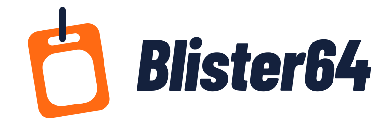
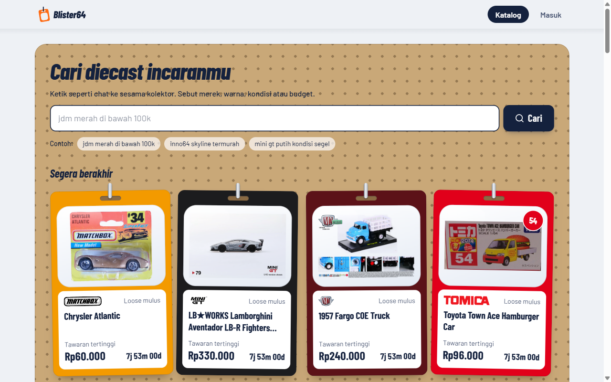
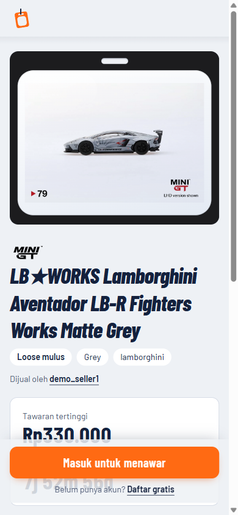

<p align="center">
  
</p>

<p align="center">
  Lelang diecast skala 1:64 dan diorama, dengan dompet escrow, anti-sniping, dan pencarian kalimat biasa.<br>
  <a href="https://blister64.ariefusry.me"><b>blister64.ariefusry.me</b></a>
</p>

<p align="center">
  
  
</p>

Penjual memasang lot, penawar menawar dengan dana yang dikunci di dompet, dan lelang ditutup otomatis dengan dana berpindah ke penjual. Katalog berisi 263 casting nyata dari Hot Wheels, Mini GT, Inno64, Matchbox, Tomica, Tarmac Works, dan M2 Machines, plus kategori diorama.

> Saldo di situs ini adalah uang simulasi. Belum ada pembayaran sungguhan.

## Fitur

- **Escrow dompet.** Tawaran mengunci dana penawar, jadi tidak ada penawar fiktif. Begitu disalip, dana kembali otomatis di transaksi yang sama. Setiap pergerakan uang tercatat di ledger yang tidak bisa diubah.
- **Anti-sniping.** Tawaran di 2 menit terakhir menambah waktu 2 menit, jadi bot tidak bisa merebut lelang di detik terakhir.
- **Beli langsung** selama tawaran tertinggi masih di bawah harganya. Penawar yang sedang memimpin otomatis mendapat dananya kembali, dan tawaran yang mencapai harga itu langsung membeli lot tanpa pernah membayar lebih dari harga yang dipasang penjual.
- **Pencarian kalimat biasa.** "jdm merah di bawah 100rb" diterjemahkan Gemini menjadi filter (merek, warna, kondisi, harga). AI hanya menghasilkan filter; query ke database tetap disusun server dengan parameter. Kalau AI gagal, pencarian jatuh ke kata kunci.
- **Rasa game saat menawar:** stiker MEMIMPIN!, alarm "Kamu disalip!" dengan tombol balas, bonus waktu +2:00, dan digit hitung mundur yang bergulir di 2 menit terakhir.
- **Chat penjual dan pemenang** untuk mengatur pengiriman, dibuka otomatis dengan pemberitahuan saat lot terjual, lengkap dengan badge belum dibaca.
- **Jam server.** Hitung mundur memakai jam server, bukan jam HP pengunjung, dan waktu berakhir ditulis dalam WIB.
- **Privasi penawar.** Riwayat tawaran menampilkan nama yang disamarkan, dan API tidak pernah mengirim ID penawar maupun pemenang.

## Teknologi

| Bagian | Pilihan |
|---|---|
| Backend | Go 1.27, `net/http`, PostgreSQL 15 lewat `pgx` (raw SQL, tanpa ORM), `golang-migrate` |
| Frontend | React 19, Vite 8, Tailwind CSS 4, React Router 8, TypeScript |
| AI | Gemini (`gemini-3.5-flash-lite`) dengan respons JSON terstruktur |
| Infrastruktur | Docker Compose, nginx, GitHub Actions, AWS EC2, Cloudflare Tunnel |

## Cara kerja inti

Setiap tawaran berjalan dalam satu transaksi database:

1. Kunci baris lelang (`SELECT ... FOR UPDATE`), supaya semua tawaran di satu lelang antre.
2. Kunci dompet yang terlibat dengan urutan `user_id` naik, supaya dua lelang tidak saling deadlock.
3. Validasi dengan jam `now()` PostgreSQL: lelang aktif, tawaran cukup tinggi, saldo cukup, bukan penjual.
4. Pindahkan dana penawar baru ke saldo terkunci, kembalikan dana penawar lama, tulis ledger, dan perpanjang waktu kalau masuk jendela anti-sniping.

Uang selalu `BIGINT` rupiah dengan `CHECK (>= 0)`, jadi database sendiri menolak saldo negatif. Worker latar menutup lelang yang habis dengan `FOR UPDATE SKIP LOCKED` dan memindahkan dana pemenang ke penjual. Concurrency diuji dengan race detector Go dan banyak penawar paralel.

## Menjalankan secara lokal

Butuh Docker. Salin `.env.example` menjadi `.env`, lalu isi `POSTGRES_PASSWORD` dan `JWT_SECRET` (minimal 32 byte).

```bash
# Seluruh stack plus katalog dan akun demo, di http://localhost:8081
docker compose --profile demo up --build
```

Akun demo: `demo_bidder1@demo.local` dengan password `demo-password` (hanya untuk lokal; di server publik isi `DEMO_PASSWORD` dengan nilai acak). Pencarian AI aktif kalau `GEMINI_API_KEY` diisi.

Untuk development dengan hot reload:

```bash
docker compose up -d db
set -a; . ./.env; set +a; go run ./cmd/api   # API di :8080
cd frontend && npm install && npm run dev     # Vite mem-proxy /api ke :8080
```

Kalau `docker compose up --build` berhenti dengan `additional privileges requested`, jalankan dengan `BUILDX_BAKE_ENTITLEMENTS_FS=0` (regresi buildx, lihat `CLAUDE.md`).

## Pengujian

```bash
# Semua test backend dengan race detector, terhadap database uji terpisah
docker compose --profile test run --rm test

# Frontend
cd frontend && npm test && npm run lint && npm run build
```

CI menjalankan `gofmt`, `go vet`, pengecekan dokumentasi Swagger, test dengan race detector, lint, test, dan build frontend, lalu build kedua image Docker di setiap push. Dokumentasi API tersedia di `/api/swagger/index.html` (lewat nginx) atau `http://localhost:8080/swagger/index.html` (API langsung).

## Struktur

```
cmd/api        server HTTP, worker penutup lelang, graceful shutdown
cmd/seed       akun demo, katalog, dan tawaran simulasi (idempoten)
cmd/scraper    pengambil data katalog dari wiki Fandom lewat MediaWiki API
internal/      service (lelang, dompet, chat, pencarian), handler, middleware, llm
migrations/    skema SQL, di-embed dan dijalankan saat API start
frontend/      SPA React
brand/         logo dan panduan identitas
docs/          runbook deploy, spesifikasi desain
```

## Deploy

Produksi berjalan di satu instance AWS EC2 tanpa port masuk sama sekali. Pengunjung datang lewat Cloudflare Tunnel, admin masuk lewat Session Manager, dan database di-backup tiap malam ke S3. Langkah lengkapnya ada di [`docs/deploy.md`](docs/deploy.md).

## Atribusi

Foto dan data katalog berasal dari wiki Fandom [Hot Wheels](https://hotwheels.fandom.com), [Mini GT](https://minigt.fandom.com), [Inno64](https://inno64.fandom.com), [Matchbox](https://matchbox.fandom.com), [Tomica](https://tomica.fandom.com), [Tarmac Works](https://tarmacworks.fandom.com), dan [M2 Machines](https://m2machines.fandom.com), dengan lisensi [CC-BY-SA](https://creativecommons.org/licenses/by-sa/3.0/). Sumber setiap item tersimpan di `items.source_url` dan ditautkan di halaman lotnya.

Nama dan logo merek adalah milik pemiliknya masing-masing. Proyek ini tidak berafiliasi dengan merek mana pun.

## Lisensi

Repo ini dipublikasikan sebagai portofolio. Tidak ada lisensi pakai ulang untuk kode dan desainnya; hak cipta tetap pada pemilik repo. Data katalog tetap berlisensi CC-BY-SA seperti tertulis di atas.
